# Presentación {.unnumbered}

Este documento constituye el manual técnico-pedagógico del **Juego de Atención Visual: Avistamiento de Aves en la Selva**, una herramienta desarrollada por el **Semillero de Cognición del Departamento de Psicología de la Universidad de los Andes, Colombia**, y presentada al Laboratorio como recurso para la enseñanza y el aprendizaje de metodologías de investigación basadas en el seguimiento ocular (*eye-tracking*).

La herramienta fue diseñada con fines académicos y formativos, para que estudiantes e investigadores puedan familiarizarse con el uso de dispositivos de seguimiento ocular —particularmente con el sistema Gazepoint GP3HD— en el estudio de los procesos atencionales.
Su diseño lúdico, orientado a niños a partir de los 7 años, permite además explorar dinámicas de investigación con participantes infantiles en contextos de laboratorio.

El presente manual integra y amplía el contenido del *README* original del proyecto con la fundamentación metodológica del sistema de puntuación (Semillero de Cognición, 2026), los principios técnicos de operación del equipo Gazepoint (Gazepoint Technologies, s.f.), y la evidencia empírica de la literatura especializada en eye-tracking y cognición visual.
El resultado es un documento de consulta que sirve simultáneamente como manual de operación de laboratorio, guía pedagógica para instructores y referencia metodológica para investigadores.

------------------------------------------------------------------------

# Objetivos Pedagógicos del Recurso

El juego de *Avistamiento de Aves en la Selva* opera en dos planos simultáneos: el plano lúdico, en el que el participante explora escenas de selva buscando aves de colores para ganar puntos, y el plano investigativo, en el que el sistema de eye-tracking registra patrones de fijación ocular que permiten inferir capacidades cognitivas del participante.
Esta dualidad convierte al juego en una plataforma de aprendizaje experiencial.

## Objetivos de aprendizaje para el estudiante-operador

Al concluir una sesión con este recurso, el estudiante-operador habrá adquirido competencias en las siguientes áreas:

1.  Introducir conceptos básicos relacionados con la atención visual y el seguimiento ocular en un contexto aplicado.
2.  Instalar, calibrar y operar el dispositivo de seguimiento ocular Gazepoint GP3HD siguiendo protocolos estandarizados (Gazepoint Technologies, s.f.).
3.  Diseñar y configurar una secuencia experimental en Gazepoint Analysis, incluyendo la carga de estímulos, la definición de Áreas de Interés (AOIs) y el ajuste de parámetros de fijación.
4.  Exportar y analizar bases de datos de métricas oculares en formato CSV.
5.  Interpretar indicadores básicos de atención visual —fijaciones, sácadas, *dwell time*, *scanpath*— en relación con el paradigma experimental del juego.
6.  Comunicar resultados de manera diferenciada a audiencias investigadoras y a participantes infantiles.

## Alcance del manual

Este documento proporciona instrucciones detalladas para:

1.  La preparación, conexión, instalación del equipo y posicionamiento del participante (Gazepoint Technologies, s.f.).
2.  La calibración del sistema mediante Gazepoint Control (Gazepoint Technologies, s.f.).
3.  El diseño, carga de estímulos y ejecución de la tarea experimental en Gazepoint Analysis (Gazepoint Technologies, s.f.).
4.  La comprensión de los registros y la exportación de bases de datos generadas por el sistema (Gazepoint Technologies, s.f.; Semillero de Cognición, 2026).
5.  La interpretación básica de las métricas obtenidas aplicadas al paradigma de *Avistamiento de Aves* (Semillero de Cognición, 2026).

## Consideraciones éticas

El uso de esta herramienta debe realizarse de acuerdo con los lineamientos éticos institucionales vigentes para la investigación con participantes humanos.
Antes de la aplicación, los participantes —y sus tutores legales, en el caso de participantes menores de edad— deben recibir información clara sobre los objetivos de la actividad, el tipo de datos registrados y las condiciones de participación, firmando los consentimientos y asentimientos informados correspondientes.

Es importante señalar que el sistema de seguimiento ocular registra exclusivamente información relacionada con la dirección de la mirada y el comportamiento visual durante la tarea (Gazepoint Technologies, s.f.), sin constituir una medida directa de pensamientos, intenciones o estados mentales de los participantes.

------------------------------------------------------------------------

# Fundamentos Teóricos

## Atención visual y búsqueda visual

La atención visual es el proceso cognitivo mediante el cual el sistema nervioso selecciona subconjuntos de la información disponible en el entorno para su procesamiento prioritario (Rayner, 1998).
En contextos experimentales, esta selección se manifiesta de manera observable a través de los movimientos oculares: el ojo humano fija la mirada —realiza *fijaciones*— sobre las regiones del campo visual que están siendo procesadas con mayor profundidad, y se desplaza entre ellas mediante movimientos rápidos denominados *sácadas*.

La búsqueda visual (*visual search*) es una forma específica de atención orientada a la tarea, en la que el observador debe localizar un estímulo objetivo (*target*) dentro de un campo visual que contiene estímulos distractores.
Rayner (1998) documentó de forma exhaustiva los patrones oculomotores asociados a la búsqueda visual, estableciendo que la eficiencia de búsqueda se puede medir a través del tiempo hasta la primera fijación (*time to first fixation*), el número total de fijaciones y la longitud del recorrido ocular (*scanpath length*).

## Modos de procesamiento visual: ambiental y focal

Velichkovsky et al. (2002) proponen una distinción fundamental entre dos modos de procesamiento visual que se diferencian por la duración de las fijaciones y la amplitud de las sácadas.
El **modo ambiental** se caracteriza por fijaciones breves (\< 140 ms) y sácadas amplias que cubren grandes regiones del campo visual; corresponde a la fase de exploración global de la escena y al procesamiento preatencional.
El **modo focal**, en cambio, involucra fijaciones sostenidas (≥ 200 ms) y sácadas cortas dentro de la región parafoveal; indica procesamiento detallado y deliberado de un objeto específico.

Esta distinción es fundamental para el sistema de puntuación del juego (véase @sec-puntuacion): únicamente las fijaciones que alcanzan o superan los 200 ms —es decir, las que corresponden inequívocamente al modo focal— son computadas como atención sostenida sobre un ave.
Fijaciones más breves reflejan barridos exploratorios sin correlato atencional deliberado (Pannasch et al., 2011).

## Control inhibitorio y función ejecutiva

El control inhibitorio es la capacidad cognitiva de suprimir respuestas prepotentes —respuestas automáticas o dominantes que resultan inapropiadas para las metas actuales del sujeto—.
En el ámbito de la atención visual, se manifiesta en la capacidad de suprimir la fijación reflexiva sobre estímulos visualmente salientes cuando éstos son irrelevantes o penalizantes para la tarea.

Lee et al. (2021) demostraron que el entrenamiento mediante eye-tracking puede mejorar el control inhibitorio en niños con Trastorno por Déficit de Atención e Hiperactividad (TDAH), en paradigmas en los que la fijación sostenida sobre el objetivo correcto —en contraste con la fijación refleja sobre distractores salientes— constituye el criterio de éxito.
El paradigma de *Avistamiento de Aves* replica esta lógica: las aves moradas son deliberadamente prominentes y están ubicadas en posiciones tentadoras del campo visual, de modo que resistir fijarlas requiere control inhibitorio activo.

El control inhibitorio tiene un desarrollo prolongado que continúa hasta los 14–16 años, con mejoras significativas entre los 7 y los 12 años (Lee et al., 2021; Catalano et al., 2026).
Esto implica que la variabilidad inter-sujeto en los puntajes refleja, en parte, diferencias legítimas en el nivel de desarrollo del control inhibitorio según la edad del participante.

## Eye-tracking como método de investigación cognitiva

El seguimiento ocular (*eye-tracking*) es una metodología no invasiva que registra la posición y el movimiento de la mirada en tiempo real, permitiendo inferir los procesos atencionales subyacentes a partir de patrones oculomotores observables.
Holmqvist et al. (2011) ofrecen una descripción comprehensiva de los métodos y medidas del eye-tracking, estableciendo que las métricas más utilizadas en investigación cognitiva son el número y la duración de fijaciones, el tiempo hasta la primera fijación, el *dwell time*, la amplitud de las sácadas y la longitud del *scanpath*.

El sistema Gazepoint GP3HD utilizado en este proyecto es un dispositivo de seguimiento ocular remoto (sin contacto) que emplea luz infrarroja para detectar la posición de la pupila y el reflejo corneal, calculando así el punto de mirada sobre la pantalla.
La precisión espacial declarada por el fabricante es de aproximadamente 0,5–1 grado de ángulo visual, suficiente para distinguir fijaciones sobre áreas de interés del tamaño de un ave en los estímulos del juego (Gazepoint Technologies, s.f.).

Catalano et al. (2026) realizaron una revisión sistemática del uso de eye-tracking en trastornos del neurodesarrollo pediátrico, concluyendo que los dispositivos de seguimiento ocular remoto ofrecen una plataforma válida y aplicable para la evaluación y el entrenamiento cognitivo en niños, siempre que se implementen protocolos de calibración adecuados y se controlen las condiciones ambientales de la sesión.

------------------------------------------------------------------------

# El Sistema Gazepoint: Hardware y Software

## El ecosistema de software

Para la ejecución de cualquier prueba con el sistema Gazepoint se requiere el uso coordinado de dos aplicaciones que interactúan simultáneamente (Gazepoint Technologies, s.f.):

- **Gazepoint Control:** Software de bajo nivel encargado de mantener en funcionamiento el escáner de hardware. Permite visualizar el rastreo ocular en tiempo real (ojo izquierdo y derecho por separado) y ejecutar el proceso esencial de calibración previo al experimento.
- **Gazepoint Analysis (v7.1):** Suite de diseño experimental donde se configuran los bloques de la tarea. Permite cargar los estímulos visuales, delimitar áreas de interés (AOIs), previsualizar las secuencias, registrar las sesiones en vivo y exportar los datos finales de la mirada en formato CSV.

Ambas aplicaciones deben estar abiertas simultáneamente durante toda la sesión experimental.
Gazepoint Control actúa como servidor de datos oculomotores y Gazepoint Analysis como cliente que consume esos datos y los asocia a los estímulos presentados.

## Componentes e instalación del hardware

Para garantizar la precisión del registro ocular, la instalación de los equipos debe seguir los siguientes pasos técnicos (Gazepoint Technologies, s.f.):

1.  **Montaje físico:** Apoye el escáner sobre el trípode suministrado para mitigar movimientos no deseados y vibraciones de la mesa de trabajo.
2.  **Conexiones de datos:** Conecte los cables de datos y de poder directamente al instrumento de eye-tracking y a los puertos USB de la computadora designada para la presentación de estímulos.
3.  **Ergonomía y distancia:** Ubique el instrumento apuntando hacia arriba, en dirección al rostro del participante, y lo más cerca posible del borde inferior del monitor (Gazepoint Research Inc., 2015). Respete las siguientes métricas recomendadas:
    - *Distancia participante–pantalla:* Aproximadamente 65 cm (\~24"), que equivale aproximadamente a la longitud del brazo de la mayoría de las personas.
    - *Altura del escáner respecto a los ojos:* Aproximadamente 40 cm (\~16") por debajo del nivel de los ojos, con el dispositivo inclinado hacia el rostro.
    - *Participantes con gafas:* Puede ser necesario acercar el escáner a unos 50 cm (\~20") del participante, manteniéndolo 40 cm por debajo del nivel de los ojos y con una inclinación mayor hacia el rostro. Esto aumenta la distancia entre el escáner y la base del monitor, lo cual es aceptable.
    - *Silla:* Se recomienda una silla de altura regulable para ajustar con facilidad la posición del participante.
    - *Iluminación:* La luz solar directa detrás o al lado del participante puede interferir con el rendimiento del seguimiento ocular.
    - *Nota:* Aunque el software tolera cierto margen de movimiento de cabeza, el uso opcional de un soporte cefálico es especialmente recomendable con participantes infantiles.

**Verificación del posicionamiento en Gazepoint Control.** Con Gazepoint Control en ejecución, el indicador circular ubicado debajo de los botones se centra y se muestra en **verde** cuando la distancia entre el participante y el escáner es óptima; si el participante está demasiado cerca o demasiado lejos, el indicador se muestra en **rojo**. Cuando el GP3 ha adquirido el seguimiento de la mirada, los ojos se resaltan con recuadros verdes (Gazepoint Research Inc., 2015). Esta verificación debe hacerse antes de iniciar la calibración. La @fig-instalacion resume el montaje.

::: {#fig-instalacion layout="[[1,1],[1]]"}
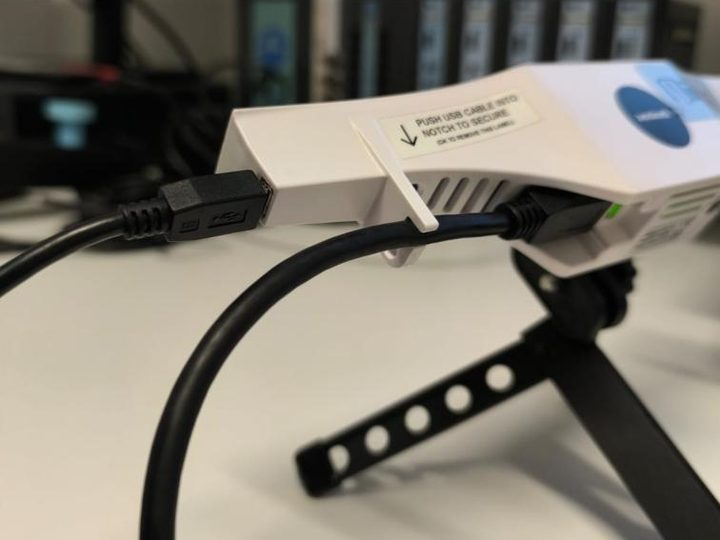{#fig-conexiones fig-alt="Escáner Gazepoint sobre su trípode con el cable USB conectado"}

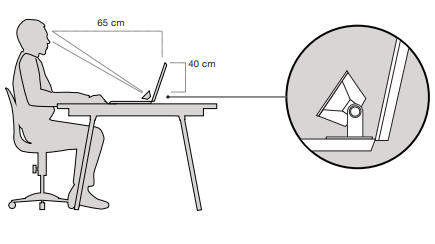{#fig-ubicacion fig-alt="Esquema de una persona sentada frente a la pantalla, a 65 cm, con el escáner 40 cm por debajo de los ojos"}

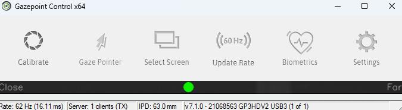{#fig-control fig-alt="Barra de herramientas de Gazepoint Control con el indicador verde de distancia y la barra de estado"}

Instalación del equipo: conexiones y trípode (a), ubicación del escáner a 65 cm y 40 cm por debajo de los ojos (b) y Gazepoint Control con el indicador verde de distancia apropiada (c). Se omite la vista de los ojos del participante. Fuente: presentación «Uso de Eye Tracker V1» (Semillero de Cognición, s.f.).
:::

## Calibración del sistema

La calibración asegura que las coordenadas en píxeles donde el usuario dirige la mirada correspondan con los datos vectoriales capturados por el sensor (Gazepoint Technologies, s.f.).
Una calibración deficiente se traduce directamente en asignaciones erróneas de las fijaciones a las AOIs, comprometiendo la validez de los datos.
El procedimiento es el siguiente:

1.  Abra **Gazepoint Control** y verifique que las siluetas verdes encuadren correctamente ambas pupilas del participante.
2.  Inicie la calibración seleccionando la modalidad de **5 puntos** (uno central y uno en cada esquina) o **9 puntos** para máxima precisión espacial.
3.  Instruya al participante para que mantenga la cabeza quieta y siga con la mirada los puntos que se iluminan secuencialmente sobre el fondo negro.
4.  Evalúe el resultado de la calibración: el mapa de error debe mostrar desviaciones menores a 1 grado de ángulo visual en el centro de la pantalla.

::: {#fig-calibracion layout-ncol=2}
{#fig-calib-punto fig-alt="Pantalla oscura de calibración con un punto numerado en una esquina"}

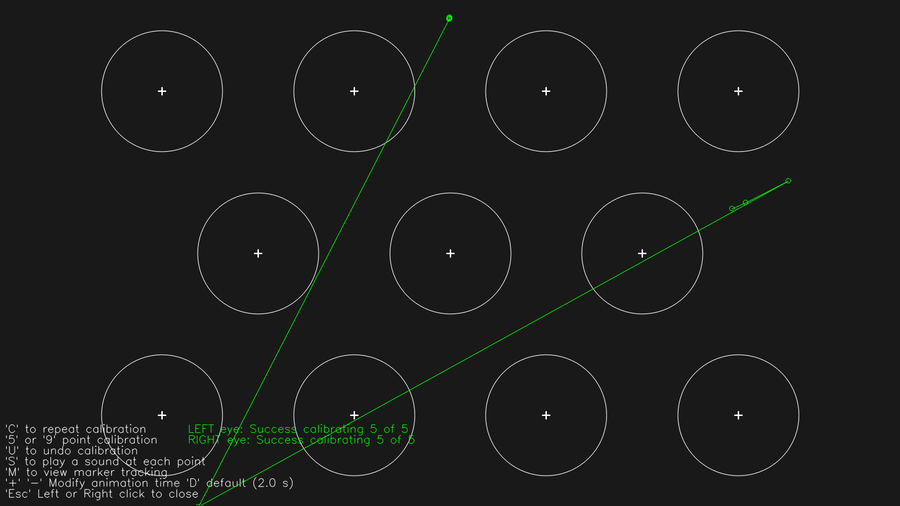{#fig-calib-validacion fig-alt="Pantalla de validación con círculos y las trayectorias de la mirada en verde"}

Pantallas de calibración: el participante sigue cada punto (a) y la mirada debe pasar por al menos 5 puntos en la validación (b). Fuente: presentación «Uso de Eye Tracker V1» (Semillero de Cognición, s.f.).
:::

**Comandos útiles de teclado durante la calibración** (Gazepoint Technologies, s.f.):

| Tecla                | Acción                                    |
|:---------------------|:------------------------------------------|
| `C`                  | Repetir la calibración completa           |
| `5` o `9`            | Alternar la cantidad de puntos del patrón |
| `U`                  | Deshacer la última calibración            |
| `S`                  | Reproducir un sonido guía en cada punto   |
| `Esc` o clic derecho | Cerrar el panel de calibración            |

::: callout-important
**Ajuste crítico antes de cada sesión:** En Gazepoint Analysis, el parámetro **Fixation Filter** viene configurado por defecto en 100 ms. Debe ajustarse a **200 ms** antes de iniciar la recolección de datos (véase @sec-umbral para la justificación metodológica).
Este ajuste es independiente de la calibración y debe verificarse al cargar el proyecto.
:::

------------------------------------------------------------------------

# El Paradigma Experimental: Avistamiento de Aves en la Selva

## Descripción y doble función del juego

El juego de *Avistamiento de Aves en la Selva* cumple dos funciones simultáneas que constituyen su principal innovación pedagógica (Semillero de Cognición, 2026):

- **Función lúdica:** El participante explora escenas de selva buscando aves de colores para acumular puntos. La narrativa es de exploración y descubrimiento, lo que favorece un estado motivacional positivo en participantes infantiles.
- **Función investigativa:** A partir de los patrones de fijación ocular registrados durante la exploración, el instrumento mide dos capacidades cognitivas diferenciadas:
  - *Búsqueda visual activa:* Localizar las aves de mayor recompensa (verdes y marrones), camufladas con la vegetación, dentro de un campo visual competitivo (Rayner, 1998).
  - *Control inhibitorio:* Suprimir fijaciones sostenidas sobre las aves penalizantes (rojas y magenta), aun cuando son los estímulos más salientes del campo visual (Lee et al., 2021).

Esta combinación de demandas cognitivas está alineada con paradigmas clásicos de investigación en atención visual y función ejecutiva, adaptados al formato lúdico para población infantil a partir de los 7 años (Semillero de Cognición, 2026).

## Población objetivo y contexto de uso

La población objetivo principal son niños **a partir de los 7 años**.
El límite inferior coincide con el período en el que el control inhibitorio experimenta mejoras más marcadas, permitiendo capturar variabilidad inter-sujeto significativa que refleja diferencias de desarrollo legítimas (Lee et al., 2021; Catalano et al., 2026).
El contexto de uso previsto es investigación en atención y función ejecutiva en formato educativo/lúdico, en laboratorios de psicología experimental con equipamiento de eye-tracking.

------------------------------------------------------------------------

# Mecánica del Juego

## Las aves y su función cognitiva

El participante observa imágenes de escenas de selva durante un tiempo determinado.
Dentro de cada escena aparecen aves agrupadas en **tres categorías funcionales**, cada una con dos variantes cromáticas (12 tipos base de aves en total), y un valor de puntos por segundo de fijación sostenida (Semillero de Cognición, 2026):

| Categoría | Colores (2 c/u) | Valor | Saliencia | Dificultad | Función cognitiva medida |
|:---|:--|:--:|:--:|:--:|:---|
| **Penalización** | Rojo · Magenta | **−5 pts/s** | Muy alta | Muy baja | Distractor inhibitorio — captura la mirada por contraste |
| **Recompensa** | Amarillo · Naranja | **+5 pts/s** | Media | Media | Objetivo secundario — visible con búsqueda breve |
| **Recompensa alta** | Verde oliva · Marrón | **+10 pts/s** | Baja | Alta | Objetivo premium — camuflado, exige búsqueda activa dirigida |

::: {#fig-aves layout-ncol=6}
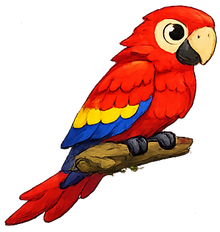{#fig-ave-rojo fig-alt="Guacamayo rojo sobre una rama"}

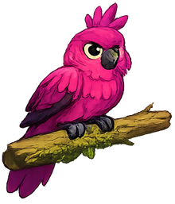{#fig-ave-magenta fig-alt="Cacatúa magenta con cresta sobre una rama"}

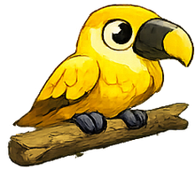{#fig-ave-amarillo fig-alt="Ave amarilla sobre una rama"}

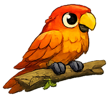{#fig-ave-naranja fig-alt="Ave naranja sobre una rama"}

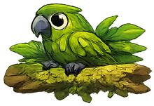{#fig-ave-verde fig-alt="Ave verde camuflada entre hojas"}

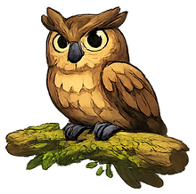{#fig-ave-marron fig-alt="Búho marrón sobre una rama"}

Ejemplos de aves de cada categoría funcional. Ilustraciones del paquete de estímulos (Semillero de Cognición, 2026).
:::

Esta organización **invierte deliberadamente** la relación habitual entre saliencia y valor, aprovechando la *ecología visual* de una selva tropical. Como el fondo está dominado por tonos verdes (Semillero de Cognición, 2026):

- El **rojo y el magenta** generan el máximo contraste cromático con el entorno: se detectan de forma rápida y automática (captura *bottom-up*), pero son justamente los estímulos que **penalizan**.
- El **amarillo y el naranja** tienen contraste moderado: son visibles y requieren una búsqueda breve; no dominan la escena.
- El **verde oliva y el marrón** son similares a hojas, ramas, musgo y corteza: se camuflan parcialmente y solo se localizan mediante una **búsqueda visual deliberada** (guiada *top-down* por la meta), por lo que reciben la **mayor recompensa**.

La regla central del sistema queda definida así: *los estímulos de penalización son los más visibles; los de recompensa, intermedios; y los de recompensa alta, los menos visibles y más integrados al entorno selvático*. Esta inversión enfrenta la **atención automática guiada por saliencia** (favorece rojo y magenta) con la **atención dirigida por objetivos** (necesaria para hallar verde y marrón), de modo que el buen desempeño exige *inhibir* lo llamativo y *sostener* una búsqueda estratégica de lo camuflado (Lee et al., 2021; Semillero de Cognición, 2026).

## Niveles de dificultad

El juego consta de **10 estímulos (E1–E10)** organizados en **5 niveles de dificultad creciente**.
La dificultad escala mediante dos mecanismos simultáneos: el aumento de la densidad de aves de **penalización** (rojo/magenta) y la reducción del tiempo de exposición; en paralelo, las aves de **recompensa alta** (verde/marrón) se mantienen escasas y cada vez más camufladas (Semillero de Cognición, 2026):

| Nivel | Nombre narrativo | Tiempo | Densidad de penalización | Recompensa alta (verde/marrón) |
|:-----:|:-----------------|:------:|:------------------------:|:------------------------------:|
|   1   | Calentamiento    | 5,0 s  | Baja                     | Accesible                      |
|   2   | Exploración      | 4,5 s  | Media-baja               | Visible con búsqueda           |
|   3   | Avistamiento     | 4,0 s  | Media                    | Parcialmente camuflada         |
|   4   | Peligro          | 3,5 s  | Alta                     | Camuflada                      |
|   5   | Maestro          | 3,0 s  | Muy alta                 | Muy camuflada / mínima         |

En los niveles iniciales (Calentamiento, Exploración) las aves de recompensa media (amarillo/naranja) son suficientemente visibles como para que la sola exploración produzca un puntaje positivo, asegurando una experiencia inicial motivadora para todos los rangos de edad.
En los niveles finales (Peligro, Maestro), la abundancia de distractores salientes (rojo/magenta) hace del **control inhibitorio** el factor determinante del puntaje (Semillero de Cognición, 2026).

::: {#fig-escenas layout-ncol=2}
{#fig-escena-e1 fig-alt="Escena de selva con un arroyo y aves de varios colores"}

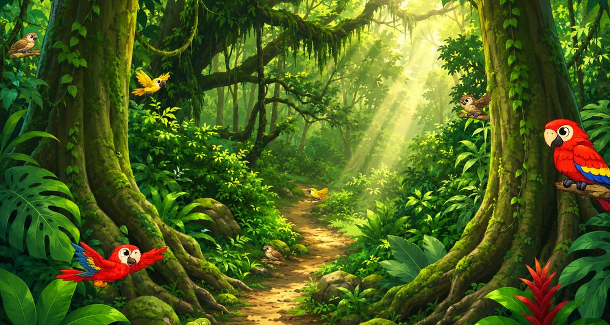{#fig-escena-e10 fig-alt="Escena de selva con árboles grandes y un camino de tierra"}

Escenas de ejemplo del primer y del último nivel de dificultad. Pueden cambiar con el rediseño del paquete de estímulos (Semillero de Cognición, 2026).
:::

::: callout-note
La composición cromática exacta por escena (número de aves de cada categoría y color) se especifica en el paquete de diseño de estímulos, actualmente en rediseño a las seis variantes cromáticas del nuevo sistema.
:::

## Secuencia de pantallas

La secuencia de presentación en Gazepoint Analysis es la siguiente:

1.  **Bienvenida** — pantalla introductoria con el título del juego.
2.  **Instrucciones** — explicación de las reglas: qué aves dan puntos y cuáles los restan.
3.  **Calibración** — punto de calibración dentro de la secuencia de medias.
4.  **¿Estás listo?** — pantalla de transición antes del inicio de los estímulos.
5.  **E1–E10** — los diez estímulos experimentales, con interludios narrativos P1, P2, P3 entre bloques de niveles.
6.  **Resultados** — pantalla de cierre; los puntajes se calculan en el dashboard externo.

------------------------------------------------------------------------

# Configuración del Experimento en Gazepoint Analysis

## Carga e introducción de estímulos

Para convertir el paradigma lúdico en un experimento funcional dentro de Gazepoint Analysis (Gazepoint Technologies, s.f.):

1.  Diríjase a la barra de herramientas principal y seleccione la opción para añadir recursos (*Media Item*).
2.  En la ventana emergente, seleccione la opción **Image** (el sistema soporta formatos `.png` y `.jpg`).
3.  Haga clic en **Browse** para buscar las ilustraciones de las escenas de selva (`E1.jpg` a `E10.jpg`), así como las pantallas auxiliares (Bienvenida, Instrucciones, "¿Estás listo?", P1–P3).
4.  En el campo **Display Duration**, configure el tiempo exacto en segundos estipulado para cada nivel (por ejemplo, `5.0` para E1–E2, `3.0` para E9–E10).
5.  Deje desactivada la casilla *Randomize Playback Order* para mantener fija la progresión de niveles de dificultad.

## Definición de Áreas de Interés (AOIs)

Las Áreas de Interés (AOIs, del inglés *Areas of Interest*) delimitan de forma invisible las zonas de la imagen donde se encuentran las aves, para que el software registre métricas aisladas sobre cada una (Gazepoint Technologies, s.f.):

1.  Seleccione la pestaña **AOI** dentro de Gazepoint Analysis.
2.  Utilice las herramientas geométricas del panel lateral (selector rectangular o de elipse) para trazar un contorno ajustado alrededor del cuerpo de cada ave (incluyendo cabeza y cola).
3.  Defina el nombre identificador con la nomenclatura estandarizada `color_N` usando los seis colores del sistema (p. ej.: `rojo_1`, `magenta_1`, `amarillo_1`, `naranja_1`, `oliva_1`, `marron_1`). Esta convención permite que los scripts de análisis y el dashboard detecten automáticamente la **categoría** del ave —y por tanto su valor de puntuación— a partir del prefijo del nombre del AOI (Semillero de Cognición, 2026).

**Prefijos, categoría y valor implícito:**

| Prefijo del AOI | Categoría | Valor implícito |
|:---|:--|:--:|
| `rojo_N` · `magenta_N` | Penalización | **−5/s** |
| `amarillo_N` · `naranja_N` | Recompensa | **+5/s** |
| `oliva_N` (o `verde_N`) · `marron_N` | Recompensa alta | **+10/s** |

El sufijo `_N` numera las aves del mismo color dentro de cada escena (p. ej. `rojo_1`, `rojo_2`, `oliva_1`). El valor no se codifica en el nombre: se deriva del prefijo de color.

## Iniciar la recolección de datos

1.  Una vez cargada la secuencia completa de medios y definidas todas las AOIs, diríjase a la pestaña **Collect Data**.
2.  Verifique que Gazepoint Control esté activo y en verde (operativo).
3.  Presione el botón rojo **¡Start Record!**.
4.  La pantalla del participante iniciará la presentación interactiva en pantalla completa, y el eye-tracker registrará de manera continua las variables cognitivas durante toda la secuencia (Gazepoint Technologies, s.f.).

------------------------------------------------------------------------

# Sistema de Puntuación {#sec-puntuacion}

> *El detalle completo, con fundamentación en la literatura y validación piloto, se encuentra en `Sistema_Puntuacion_Avistamiento_Aves.docx` (Semillero de Cognición, 2026).*

## Descripción general y fórmula de cálculo

El sistema de puntuación cuantifica la calidad de la atención visual del participante integrando el tiempo de fijación sostenida sobre cada ave y el valor de puntuación asignado a su color (Semillero de Cognición, 2026):

$$\text{Puntaje\_total} = \sum_{i} (t_i \times v_i) \quad \text{para toda fijación } i \text{ donde } t_i \geq 0{,}2 \text{ s}$$

donde:

- $t_i$ = tiempo de fijación acumulado en el AOI $i$ (en segundos),
- $v_i$ = valor de la categoría del AOI $i$: $+10$ (recompensa alta: verde/marrón), $+5$ (recompensa: amarillo/naranja) o $-5$ (penalización: rojo/magenta),
- solo se computan fijaciones con duración $t_i \geq 0{,}2$ s (umbral de 200 ms).

Los valores de tiempo corresponden a la columna **Ave Time Viewed (sec)** del *Data Summary Export* exportado por Gazepoint Analysis, una vez configurado el Fixation Filter en 200 ms (Gazepoint Technologies, s.f.; Semillero de Cognición, 2026).

## Parámetro 1: Umbral de fijación mínima (200 ms) {#sec-umbral}

### Definición y justificación

Una fijación ocular es un período de estabilidad relativa del ojo durante el cual el cerebro procesa información visual de la región foveada.
Se distingue de las sácadas —movimientos rápidos entre fijaciones— y de los movimientos reflejos de muy corta duración.
Determinar un umbral mínimo de duración es esencial para asegurar que solo se computen fijaciones con correlato cognitivo real (Holmqvist et al., 2011).

En el presente instrumento se establece un **umbral mínimo de 200 ms (0,2 segundos)**.
Fijaciones de duración inferior a este valor no contribuyen al cálculo del puntaje (Semillero de Cognición, 2026).

### Fundamento en la literatura

La literatura establece de forma consistente que las fijaciones intencionales en adultos tienen una duración modal entre 200 y 350 ms durante la percepción de escenas visuales (Rayner, 1998; Pannasch et al., 2011).
Fijaciones por debajo de 100 ms corresponden predominantemente a movimientos sacádicos involuntarios sin correlato atencional sostenido.

Velichkovsky et al. (2002) establecen empíricamente que fijaciones de 140–200 ms marcan la transición entre procesamiento preatencional y procesamiento focal: fijaciones ≥ 200 ms inician sácadas cortas dentro de la región parafoveal, indicando procesamiento focal del objeto.
Esta evidencia sustenta directamente el umbral adoptado.

En cuanto a la población infantil, Rayner (1986) documentó que niños de 7–12 años producen fijaciones más largas y sácadas más cortas que adultos, con duraciones medias de fijación entre 250 y 400 ms, lo que hace el umbral de 200 ms apropiado y no excesivamente exigente para esta franja etaria.
Kooiker et al. (2016) y Rider et al. (2018) documentan mayor variabilidad intersujeto en fijaciones de niños de 6–12 años, con un mayor porcentaje de fijaciones muy breves (\< 150 ms) producidas por movimientos sacádicos involuntarios, lo que refuerza la necesidad del umbral.

Desde una perspectiva de estándares metodológicos, el algoritmo de detección de fijaciones I-DT (*Identification by Dispersion Threshold*; Salvucci & Goldberg, 2000) recomienda un umbral de duración mínima entre 100 y 300 ms dependiendo de las demandas de la tarea.
Para tareas de percepción de escenas con objetos identificables, el valor de 200 ms es el más adoptado en la literatura reciente (Holmqvist et al., 2011; WorldViz, 2024).

### Validación con datos piloto

El análisis de la sesión piloto (*n* = 3 participantes, 9 imágenes, 89 AOIs visitados) reveló que el 39% de las fijaciones registradas tenían duración inferior a 200 ms —correspondiendo a barridos visuales exploratorios, no a atención sostenida sobre un ave específica (Semillero de Cognición, 2026).
La distribución completa se presenta en la @tbl-fijaciones.

| Rango de duración | N fijaciones | \% del total | Clasificación |
|:---|:--:|:--:|:---|
| 0 – 100 ms | 20 | 22% | Refleja / involuntaria (excluida) |
| 100 – 200 ms | 15 | 17% | Transicional (excluida) |
| 200 – 300 ms | 17 | 19% | Focal (incluida) |
| 300 – 500 ms | 18 | 20% | Focal sostenida (incluida) |
| 500 ms – 1 s | 11 | 12% | Focal profunda (incluida) |
| 1 s – 2 s | 3 | 3% | Fijación prolongada (incluida) |
| \> 2 s | 5 | 6% | Fijación muy prolongada (incluida) |

: Distribución de fijaciones por rango de duración — sesión piloto (*n* = 3, 89 AOIs visitados). Fuente: Semillero de Cognición (2026).

### Implementación en Gazepoint

El umbral se configura en el parámetro **Fixation Filter** de Gazepoint Analysis.
El valor por defecto del software es 100 ms; debe ajustarse a **200 ms antes de cada sesión**.
Este ajuste afecta tanto el cálculo de *Ave Time Viewed (sec)* como el conteo de *Ave Fixations (#)* en el archivo de exportación *Data Summary* (Gazepoint Technologies, s.f.; Semillero de Cognición, 2026).

## Parámetro 2: Escala de puntuación por categoría (+10 / +5 / −5)

### Fundamento del ratio entre recompensas (alta vs. media)

La elección de +10 para la recompensa alta (verde/marrón) y +5 para la recompensa media (amarillo/naranja) responde a dos principios complementarios (Semillero de Cognición, 2026):

1.  La proporción **2:1** crea una diferencia perceptible entre quienes realizan la búsqueda dirigida hacia los objetivos camuflados de mayor valor y quienes se conforman con las recompensas medias, más accesibles, maximizando la discriminación entre perfiles atencionales distintos.
2.  La diferencia es suficientemente grande para motivar la búsqueda activa de los objetivos camuflados, sin que la recompensa media sea irrelevante como objetivo alternativo, en línea con principios de diseño de tareas de búsqueda visual en contextos lúdicos con población infantil (Lee et al., 2021).

### Calibración de la penalización (rojo/magenta: −5 pts/s)

El valor de −5 pts/s fue establecido tras evaluar un valor original de −7 pts/s contra los datos piloto.
Con −7 pts/s y la distribución real de fijaciones en los niveles 4 y 5 —donde los distractores salientes dominan el campo visual—, el puntaje final resultaba negativo de forma estructural, independientemente de la estrategia del participante.
Esto viola un principio fundamental de validez del instrumento: el puntaje debe reflejar la conducta del sujeto, no un sesgo del diseño (Semillero de Cognición, 2026).

El valor de −5 pts/s presenta tres propiedades deseables:

1.  **Ratio 1:1 con la recompensa media:** 1 segundo en un ave de penalización (rojo/magenta) se cancela exactamente con 1 segundo en una de recompensa media (amarillo/naranja). Esta simetría es cognitivamente intuitiva para niños de 7 años en adelante y facilita el aprendizaje estratégico a lo largo de los niveles.
2.  **Recuperabilidad:** Un participante que fija un distractor durante 2 segundos puede recuperar esos puntos fijando 1 segundo en un ave de recompensa alta. Esto mantiene la motivación incluso ante errores, lo que es especialmente relevante en población infantil.
3.  **Penalización genuina:** Con el umbral de 200 ms, las fijaciones que sí se computan son inequívocamente intencionales; por tanto, −5 pts/s es una consecuencia justificada de una decisión atencional real, no un castigo por movimiento reflejo (Velichkovsky et al., 2002; Semillero de Cognición, 2026).

### Consideraciones para población infantil (a partir de 7 años)

El control inhibitorio tiene un desarrollo prolongado que continúa hasta los 14–16 años, con mejoras significativas entre los 7 y los 12 años (Lee et al., 2021; Catalano et al., 2026).
Los participantes más jóvenes (7–9 años) tendrán mayor dificultad para suprimir fijaciones en los distractores rojos y magenta visualmente dominantes, lo que el sistema capta como varianza legítima entre grupos de edad.

La penalización de −5 (frente a −7) es especialmente relevante para niños de 7–9 años: con un control inhibitorio en desarrollo, una penalización excesiva en los niveles finales puede producir puntajes negativos que desmotivan al participante sin que ello refleje falta de esfuerzo, sino desarrollo cognitivo normal para su edad.
El valor calibrado de −5 preserva la validez motivacional del instrumento en toda la franja etaria objetivo (Semillero de Cognición, 2026).

## Parámetro 3: Tratamiento de AOIs no visitadas o con fijaciones subumbrales

El sistema distingue dos casos especiales (Semillero de Cognición, 2026):

- **AOI no visitada** (tiempo registrado = −1 en Gazepoint): el ave no fue detectada. Contribución al puntaje = **0**.
- **AOI visitada con fijación subumbral** (0 \< tiempo \< 0,2 s): el participante orientó brevemente la mirada hacia el ave, pero sin atención sostenida. Contribución al puntaje = **0**.

En ambos casos, la contribución es neutra: el sistema no penaliza por no haber encontrado un ave, ni premia barridos visuales rápidos.
Solo la fijación genuinamente sostenida (≥ 200 ms) genera consecuencias en el puntaje.

------------------------------------------------------------------------

# Validación Piloto del Sistema de Puntuación

Se analizó una sesión piloto con 3 participantes (9 imágenes, 89 AOIs visitados) utilizando el sistema de puntuación calibrado (−5 pts/s, umbral 200 ms).
Los resultados muestran que el instrumento discrimina entre patrones atencionales distintos con un rango de puntaje total de 139 puntos entre el máximo y el mínimo observado (Semillero de Cognición, 2026), como se presenta en la @tbl-piloto.

::: callout-warning
**Nota sobre el rediseño.** La sesión piloto se realizó con la versión **previa** de tres colores (premium = amarillo +10, intermedio = rojo +5, penalización = morado −5). El nuevo sistema de seis colores y tres categorías **preserva las magnitudes** (+10 / +5 / −5), por lo que los puntajes piloto siguen siendo válidos como demostración de discriminación; lo que cambia es el mapeo color→categoría (la recompensa alta pasa a verde/marrón y la penalización a rojo/magenta). Los perfiles deben leerse en términos de **categoría de valor**, no del color específico de aquellos estímulos.
:::

| Participante | Puntaje total | Tiempo amarillo (s) | Tiempo rojo (s) | Tiempo morado (s) | Estrategia identificada |
|:--:|:--:|:--:|:--:|:--:|:---|
| P3 | +120,4 | 14,5 | 0,3 | 6,1 | Amarillo-dominante: búsqueda activa del objetivo premium |
| P1 | +48,8 | 2,1 | 7,5 | 1,9 | Rojo-dominante: refugio seguro como objetivo principal |
| P2 | −18,2 | 0,0 | 0,4 | 4,1 | Sin estrategia: fijaciones dispersas, morados por defecto |

: Resultados por participante — sesión piloto (sistema calibrado). Fuente: Semillero de Cognición (2026).

Los tres perfiles identificados —amarillo-dominante, rojo-dominante y sin estrategia deliberada— corresponden a patrones atencionales teóricamente distinguibles, lo que apoya la validez de constructo del instrumento (Semillero de Cognición, 2026).
En particular:

- **P3** demuestra búsqueda visual activa eficiente: invierte la mayor parte del tiempo fijando aves amarillas a pesar de que son las más difíciles de localizar.
- **P1** adopta la estrategia de refugio seguro: maximiza tiempo en rojos (alta saliencia, bajo riesgo) y evita los morados.
- **P2** muestra ausencia de estrategia deliberada: el tiempo se concentra en morados (distractores salientes) sin contrarrestarlo con fijaciones en aves positivas.

------------------------------------------------------------------------

# Podio y Sistema de Clasificación Narrativa

## Clasificación por niveles

Para facilitar la comunicación de resultados a participantes infantiles, el sistema establece una clasificación narrativa que traduce el puntaje numérico a una categoría significativa (Semillero de Cognición, 2026):

| Nivel | Rango de puntaje | Descripción |
|:---|:--:|:---|
| 🏆 Maestro Avistador | \> 100 pts | Control atencional óptimo: inhibió los distractores y buscó la recompensa alta camuflada (verde/marrón). |
| 🥇 Avistador Experto | 50 – 99 pts | Estrategia eficiente: combina recompensas medias y altas. |
| 🥈 Explorador | 0 – 49 pts | Explora activamente pero sin estrategia clara de búsqueda. |
| 🥉 Aprendiz | Negativo | Los distractores rojos y magenta fueron muy tramposos: más práctica necesaria. |

::: callout-note
La clasificación narrativa está diseñada para la comunicación al participante en el contexto lúdico.
El **análisis de investigación siempre utiliza el puntaje continuo**, que es la variable cuantitativa con mayor poder discriminativo (Semillero de Cognición, 2026).
:::

## Generación del ranking y el podio

Cuando participan múltiples jugadores en una misma sesión, el dashboard de resultados genera automáticamente un ranking ordenado de mayor a menor puntaje.
La lógica de clasificación es la siguiente:

1.  El *Data Summary Export* de Gazepoint Analysis contiene una fila por participante por AOI visitado.
2.  El script de cálculo (implementado en el dashboard HTML y opcionalmente en Python/pandas) aplica la fórmula de puntaje a cada participante, filtrando fijaciones subumbrales y asignando el valor de color según el prefijo del nombre del AOI.
3.  Los puntajes totales se ordenan de mayor a menor y se asigna la clasificación narrativa según los rangos de la tabla anterior.
4.  El podio se exporta como imagen (`…_podio.png`) y el ranking completo como CSV (`…_resultados.csv`) para documentación del estudio.

------------------------------------------------------------------------

# Extracción de Datos y Diccionario de Métricas Oculares

## Procedimiento de exportación

Al finalizar las pruebas, el software consolida los archivos de fijaciones en el proyecto.
Para extraer los datos (Gazepoint Technologies, s.f.; Semillero de Cognición, 2026):

1.  Dentro de Gazepoint Analysis, haga clic en el botón **Export** de la barra superior.
2.  En la ventana de diálogo, configure la ruta de guardado hacia `Gazepoint/result/` bajo el formato **Data Summary Export** (`.csv`).
3.  El archivo generado contiene la división estadística detallada por cada usuario y por cada AOI registrada durante la sesión.

## Diccionario de métricas exportadas

A continuación se describen las métricas exportadas en el CSV de Gazepoint que los estudiantes deben analizar en el dashboard interactivo (Gazepoint Technologies, s.f.; Holmqvist et al., 2011):

| Medida | Nombre en CSV | Descripción e importancia cognitiva |
|:---|:---|:---|
| **Número de fijaciones** | `Fixation Count` | Cantidad total de veces que la mirada se detuvo de forma estable dentro del AOI. |
| **Duración de fijación (ms)** | `Fixation Duration` | Tiempo promedio de cada fijación individual. Relacionado con la carga de procesamiento del estímulo (Rayner, 1998). |
| **Tiempo a la primera fijación** | `Time to First Fixation` | Tiempo desde que aparece el estímulo hasta el primer contacto visual con el AOI. Mide la saliencia visual del ave. |
| **Tiempo total de visita** | `Dwell Time` | Tiempo total neto acumulado en el AOI. Variable base del sistema de puntuación (Semillero de Cognición, 2026). |
| **Duración de primera fijación** | `First Fixation Duration` | Duración del primer impacto visual. Evalúa el interés inicial generado por el estímulo. |
| **Conteo de sacádicos** | `Saccade Count` | Número de movimientos rápidos entre puntos de fijación (Holmqvist et al., 2011). |
| **Amplitud del sacádico** | `Saccade Amplitude` | Distancia promedio de cada sacádico en grados de ángulo visual. Refleja si la exploración es local o global (Velichkovsky et al., 2002). |
| **Diámetro de la pupila (mm)** | `Pupil Diameter` | Tamaño promedio de la apertura pupilar. Indicador de esfuerzo cognitivo o activación emocional (Holmqvist et al., 2011). |
| **Conteo de parpadeos** | `Blink Count` | Frecuencia de parpadeos. Útil para evaluar fatiga visual a lo largo de los niveles. |
| **Longitud del recorrido** | `Scanpath Length` | Extensión lineal total de la trayectoria ocular sobre la imagen. Mide la eficiencia de la estrategia de búsqueda visual (Rayner, 1998; Holmqvist et al., 2011). |

------------------------------------------------------------------------

# Herramientas de Análisis y Dashboard de Resultados

## Stack tecnológico del proyecto

| Componente | Herramienta |
|:---|:---|
| **Eye-tracking** | Gazepoint GP3HD + Gazepoint Analysis v7.1 (Gazepoint Technologies, s.f.) |
| **Estímulos** | Ilustraciones estilo *storybook* generadas por IA (1440 × 810 px, JPG) |
| **Presentación de estímulos** | Gazepoint Analysis (secuencia de medias) |
| **Análisis de datos** | Dashboard HTML interactivo (navegador) y/o script Python (pandas, matplotlib) |
| **Tipografía del dashboard** | Poppins + Nunito (Google Fonts) |

## Uso del dashboard de resultados

El archivo `avistamiento_dashboard.html` es una aplicación web autocontenida que procesa el CSV exportado por Gazepoint y calcula los puntajes, el ranking y las métricas de investigación.
Para utilizarlo:

1.  Abra `avistamiento_dashboard.html` con doble clic en cualquier navegador web (no requiere instalación ni conexión a internet).
2.  Haga clic en **📂 Cargar CSV** para procesar el archivo exportado de Gazepoint (ubicado en `Gazepoint/result/`).
3.  Intercambie entre las dos vistas pedagógicas diferenciadas:
    - **🐤 Vista Niños:** Podio interactivo gamificado con avatares de aves y clasificación narrativa, diseñado para devolver retroalimentación inmediata y motivadora al participante.
    - **🔬 Vista Investigador:** Panel con KPIs estadísticos, distribuciones de fijaciones, pupilometría y longitud de exploración, orientado a reportes formales de laboratorio (Semillero de Cognición, 2026).

------------------------------------------------------------------------

# Estructura del Proyecto

La siguiente jerarquía describe la organización de archivos y carpetas del proyecto:

```
Eye_Tracker_Birds_Game/
├── README.md                                  ← Descripción general del proyecto
├── manual_eyetracking_avistamiento.qmd        ← Este documento (manual, fuente en Quarto)
├── manual_eyetracking_avistamiento.html       ← Manual renderizado
├── avistamiento_dashboard.html                ← App de resultados (abrir en navegador)
├── Uso de Eye Tracker V1.pdf                  ← Presentación de instalación y uso del equipo
├── Eye_Tracker_Birds_Game.Rproj               ← Proyecto de RStudio
│
├── assets/                                    ← Imágenes que usan el manual y el dashboard
│
├── Diseño de estímulos/                       ← Activos visuales (en diseño)
│   ├── A1.png … A15.png                       ← Ilustraciones individuales de las aves
│   ├── E1.png … E10.png                       ← Escenas-estímulo de los 10 niveles
│   ├── T1.png … T9.png                        ← Pantallas de transición entre escenas
│   ├── Template 1.png … Template 3.png        ← Hojas de plantillas con las variantes de aves
│   └── Estímulos.pptx                         ← Presentación de trabajo de los estímulos
│
└── Gazepoint/                                 ← PROYECTO DE GAZEPOINT ANALYSIS (no editar a mano)
    ├── BirdsGame.prj                          ← Archivo de proyecto de Gazepoint Analysis
    ├── user/                                  ← Datos de usuarios/sesiones (lo gestiona el software)
    ├── src/                                   ← Medios/estímulos del proyecto (lo gestiona el software)
    └── result/                                ← Exportaciones (Data Summary CSV) que alimentan el dashboard
        └── Dataset prueba.csv                 ← Dataset de prueba anonimizado (8 usuarios)
```

En el repositorio de GitHub solo se publica `Gazepoint/result/`; el resto de `Gazepoint/` queda fuera porque puede contener información personal de los participantes.

Los activos visuales en diseño viven en `Diseño de estímulos/`: las ilustraciones individuales de las aves (`A1`–`A15`, con las seis variantes cromáticas del nuevo sistema), las escenas-estímulo (`E1`–`E10`), las pantallas de transición (`T1`–`T9`) y hojas de plantillas con las variantes de aves (`Template 1`–`3`). `Estímulos.pptx` es el archivo de trabajo.

## La carpeta `Gazepoint/` como proyecto de análisis

La carpeta `Gazepoint/` **no es una carpeta cualquiera**: es un proyecto de Gazepoint Analysis con la estructura que el propio software crea y administra —el archivo de proyecto `BirdsGame.prj` y las subcarpetas `User/` (datos de sesiones), `src/` (medios) y `result/` (exportaciones) (Gazepoint Technologies, s.f.).

::: callout-important
Se recomienda **conservar intacta** esta estructura y **no modificarla manualmente**: Gazepoint Analysis depende de ella para funcionar, y es el propio software quien crea y gestiona estas carpetas. Cualquier reorganización debe hacerse desde Gazepoint Analysis, no desde el explorador de archivos.
:::

**De esta carpeta salen los resultados del estudio:** Gazepoint registra la sesión y exporta el *Data Summary* a `Gazepoint/result/`, y de ese CSV el dashboard calcula los puntajes.
El flujo completo es:

```
Gazepoint GP3HD (sesión en vivo)
        ↓
Gazepoint Analysis (registro + procesamiento; gestiona la carpeta Gazepoint/)
        ↓
Gazepoint/result/Data_Summary_export_*.csv
        ↓
Dashboard HTML (avistamiento_dashboard.html)
        ↓
Puntajes, podio y métricas
```

------------------------------------------------------------------------

# Instrucciones de Operación en el Laboratorio

## Lista de verificación previa a cada sesión

Antes de iniciar la recolección de datos, verifique los siguientes puntos:

1.  **Fixation Filter configurado en 200 ms** en Gazepoint Analysis (viene en 100 ms por defecto).
2.  **Secuencia completa de medios cargada:** Bienvenida → Instrucciones → Calibración → "¿Estás listo?" → E1–E10 (con interludios P1, P2, P3) → Resultados.
3.  **Duración de cada estímulo ajustada por nivel:**
    - E1–E2: 5,0 s · E3–E4: 4,5 s · E5–E6: 4,0 s · E7–E8: 3,5 s · E9–E10: 3,0 s.
4.  **Nomenclatura de AOIs verificada:** `rojo_N` · `magenta_N` (penalización), `amarillo_N` · `naranja_N` (recompensa), `oliva_N` · `marron_N` (recompensa alta) en todas las escenas (Semillero de Cognición, 2026).
5.  **Calibración exitosa:** mapa de error \< 1 grado en el centro de pantalla.
6.  **Consentimientos informados obtenidos** según los lineamientos éticos institucionales.

## Exportación de datos

Tras finalizar las grabaciones, exporte el **Data Summary** desde Gazepoint Analysis.
Esto genera el archivo CSV con el desglose por AOI y por participante, que alimenta el dashboard de análisis (Gazepoint Technologies, s.f.; Semillero de Cognición, 2026).

------------------------------------------------------------------------

# Estado del Proyecto y Pendientes

**Completado:**

- ✅ Sistema de puntuación calibrado y documentado con fundamentación en la literatura de fijaciones (Semillero de Cognición, 2026).
- ✅ Dashboard de resultados funcional con vistas duales (niños / investigador) y carga dinámica de CSV.
- ✅ Dataset de prueba de 8 jugadores simulados para validación del pipeline de análisis.
- ✅ Estructura unificada de hardware, calibración y software en el manual técnico.
- ✅ Ilustraciones de las aves del nuevo sistema de seis colores / tres categorías (`Diseño de estímulos/A1.png` a `A15.png`).

**Pendiente:**

- ⏳ Finalización de las escenas-estímulo E1–E10 en `Diseño de estímulos/Estímulos.pptx` y su exportación a imágenes para Gazepoint.
- ⏳ Definición de AOIs sobre las aves de cada escena con la nomenclatura de seis colores en Gazepoint Analysis.
- ⏳ Integración física en el laboratorio de psicología y pruebas de calibración con la distancia de escaneo específica del espacio.
- ⏳ Diseño de pantallas auxiliares con el concepto de aves (Bienvenida, Instrucciones, "¿Estás listo?", interludios P1–P3 y pantalla de resultados).

------------------------------------------------------------------------

# Créditos

Proyecto **diseñado por Daniel Alejandro Socha Castelblanco**, estudiante de la Maestría en Psicología de la **Universidad de los Andes** (Colombia), con el apoyo de **Henry Armando Delgado Martínez** y **William Jiménez-Leal**.

Desarrollado como recurso pedagógico para el Laboratorio de Psicología del Departamento de Psicología de la Universidad de los Andes, junio de 2026.

El sistema de puntuación y su fundamentación metodológica se documentan en el documento técnico interno del proyecto *Avistamiento de Aves en la Selva: Sistema de Puntuación y Parámetros Metodológicos* (Universidad de los Andes, 2026).

------------------------------------------------------------------------

# Referencias

Esta lista incluye **únicamente artículos con DOI verificado**. Las demás fuentes citadas en el texto que no son artículos con DOI —la documentación técnica del equipo Gazepoint (Gazepoint Technologies, s.f.), la guía de posicionamiento *GP3 Placement and Positioning Instructions* (Gazepoint Research Inc., 2015), la guía metodológica de Holmqvist et al. (2011, libro), la documentación de WorldViz/SightLab (2024), la presentación «Uso de Eye Tracker V1» (Semillero de Cognición, s.f.) y el documento técnico interno del proyecto— se citan en el cuerpo del manual como fuentes primarias o técnicas y no se listan aquí.

Catalano, G., Abbondio, S., Nicotra, R., Berselli, V., Guarischi, M., Vezzali, V., & Signorini, S. (2026).
Eye tracking for rehabilitation and training in paediatric neurodevelopmental disorders: A systematic review.
*Brain Sciences*, *16*(3), 337.
<https://doi.org/10.3390/brainsci16030337>

Kooiker, M. J. G., Pel, J. J. M., Verbunt, H. J. M., de Wit, G. C., van Genderen, M. M., & van der Steen, J. (2016).
Quantification of visual function assessment using remote eye tracking in children: Validity and applicability.
*Acta Ophthalmologica*, *94*(6), 599–608.
<https://doi.org/10.1111/aos.13038>

Lee, Y.-C., Yang, H.-J., Chen, V. C.-H., Lee, W.-T., Teng, M.-J., Lin, C.-H., & Gossop, M. (2021).
Eye-tracking training improves inhibitory control in children with attention-deficit/hyperactivity disorder.
*Brain Sciences*, *11*(3), 314.
<https://doi.org/10.3390/brainsci11030314>

Pannasch, S., Schulz, J., & Velichkovsky, B. M. (2011).
On the control of visual fixation durations in free viewing of complex images.
*Attention, Perception, & Psychophysics*, *73*(4), 1120–1132.
<https://doi.org/10.3758/s13414-011-0090-1>

Rayner, K. (1986).
Eye movements and the perceptual span in beginning and skilled readers.
*Journal of Experimental Child Psychology*, *41*(2), 211–236.
<https://doi.org/10.1016/0022-0965(86)90037-8>

Rayner, K. (1998).
Eye movements in reading and information processing: 20 years of research.
*Psychological Bulletin*, *124*(3), 372–422.
<https://doi.org/10.1037/0033-2909.124.3.372>

Rider, A. T., Coutrot, A., Pellicano, E., Dakin, S. C., & Mareschal, I. (2018).
Semantic content outweighs low-level saliency in determining children's and adults' fixation of movies.
*Journal of Experimental Child Psychology*, *166*, 293–309.
<https://doi.org/10.1016/j.jecp.2017.09.002>

Salvucci, D. D., & Goldberg, J. H. (2000).
Identifying fixations and saccades in eye-tracking protocols.
*Proceedings of the Eye Tracking Research & Applications Symposium (ETRA '00)*, 71–78.
<https://doi.org/10.1145/355017.355028>

Velichkovsky, B. M., Rothert, A., Kopf, M., Dornhoefer, S. M., & Joos, M. (2002).
Towards an express-diagnostics for level of processing and hazard perception.
*Transportation Research Part F: Traffic Psychology and Behaviour*, *5*(2), 145–156.
<https://doi.org/10.1016/S1369-8478(02)00013-X>
